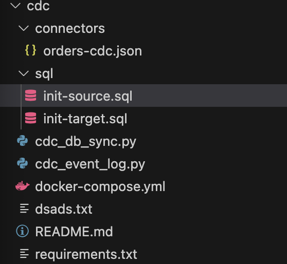
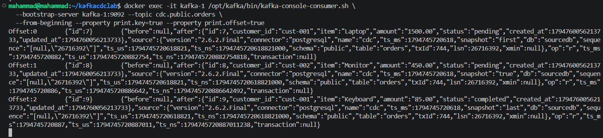
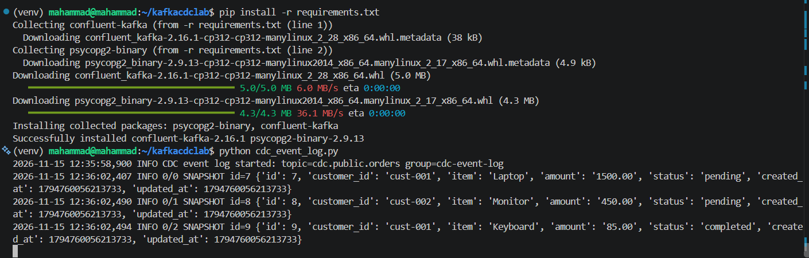
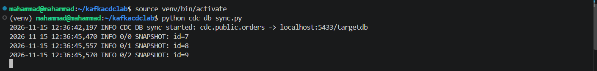
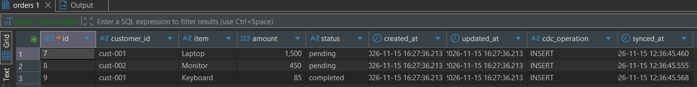
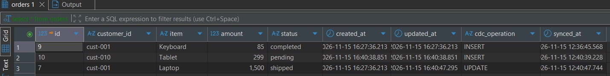

# Kafka CDC Lab: Postgres → Debezium → Kafka → Postgres (Hard Delete)

Matrix Academy, Lesson 32 (Kafka CDC) tapşırığı.

**Tapşırıq:** `cdc_db_sync.py`-dakı **soft delete**-i **hard delete** ilə əvəz etmək.

## 1. Arxitektura

```
postgres-source (sourcedb.orders)
        │  WAL (wal_level=logical, pgoutput)
        ▼
Debezium (kafka-connect) ──► Kafka topic: cdc.public.orders (3 broker)
                                   │
                  ┌────────────────┴────────────────┐
                  ▼                                 ▼
        cdc_event_log.py                    cdc_db_sync.py
        (event-ləri log-a yazır)            (postgres-target.orders-a yazır)
```

- Source DB: `localhost:5432/sourcedb`
- Target DB: `localhost:5433/targetdb`
- Debezium event növləri: `r` (snapshot), `c` (insert), `u` (update), `d` (delete). Silmədən sonra Debezium əlavə olaraq `null` value-lu **tombstone** mesajı göndərir (kod onu keçir).

## 2. Qovluq strukturu



## 3. Necə işə salınır

```bash
docker compose up -d
docker compose ps        # kafka-connect healthy olmalıdır

# Debezium connector
curl -s -X POST -H "Content-Type: application/json" \
  --data @connectors/orders-cdc.json http://localhost:8083/connectors
curl -s http://localhost:8083/connectors/orders-cdc-connector/status | python3 -m json.tool

# Python mühiti
python3 -m venv venv
source venv/bin/activate
pip install -r requirements.txt

# Terminal A
python cdc_event_log.py
# Terminal B
python cdc_db_sync.py
```

## 4. Nə dəyişdirdim

### 4.1. Əsas dəyişiklik: soft delete → hard delete (`cdc_db_sync.py`)

**Əvvəl (soft delete):** `d` event-i gələndə sətir silinmirdi, yalnız status dəyişirdi.

```python
SOFT_DELETE_SQL = """
    UPDATE orders
    SET status = 'deleted', cdc_operation = 'DELETE', synced_at = NOW()
    WHERE id = %(id)s
"""
...
if op == "d":
    cur.execute(SOFT_DELETE_SQL, {"id": before["id"]})
    return f"DELETE id={before['id']} -> soft deleted"
```

**İndi (hard delete):** sətir target cədvəldən fiziki olaraq silinir.

```python
HARD_DELETE_SQL = """
    DELETE FROM orders
    WHERE id = %(id)s
"""
...
if op == "d":
    cur.execute(HARD_DELETE_SQL, {"id": before["id"]})
    return f"DELETE id={before['id']} -> hard deleted (rows affected: {cur.rowcount})"
```

Qeydlər:
- Silmək üçün yalnız `id` lazımdır, o da `before` daxilində həmişə gəlir (`REPLICA IDENTITY DEFAULT` olsa belə).
- `DELETE` idempotentdir: sətir yoxdursa xəta vermir, 0 sətir silir.
- Hard delete-dən sonra target-də `cdc_operation = 'DELETE'` izi qalmır, silinmə tarixçəsi itir (lazım olsa ayrıca audit cədvəli əlavə etmək olar).

### 4.2. Koddakı digər düzəlişlər

| Fayl | Problem | Düzəliş |
|---|---|---|
| `cdc_db_sync.py` | `Producer` import olunmayıb, `send_to_dlq(producer: Producer, ...)` `NameError` verirdi | `from confluent_kafka import Consumer, Producer` |
| `cdc_db_sync.py` | Xəta olanda mesajın offset-i commit olunurdu, mesaj itirdi | Xətalı mesaj DLQ topic-ə (`cdc.public.orders.dlq`) göndərilir; offset yalnız DLQ-ya göndərmə uğurlu olanda commit olunur |
| `cdc_event_log.py` | `msg.error()` olan mesaj da commit olunurdu | Error mesajı log-lanır və `continue` ilə keçilir |
| `docker-compose.yml` | Typo: `KAFKA_CLUSTERS_0_KAFKACONNE_ADDRESS` | `KAFKA_CLUSTERS_0_KAFKACONNECT_0_ADDRESS` |
| `sql/` | `init-source.sql` və `init-target.sql` compose-da istinad olunurdu, amma yox idi | `orders` cədvəlləri və 3 başlanğıc sətir yazıldı |

## 5. Test nəticələri

### 5.1. Debezium snapshot Kafka topic-ə düşüb

Connector `RUNNING`-dir, `cdc.public.orders` topic-ində 3 event var (`"op":"r"`, id = 7, 8, 9).



### 5.2. `cdc_event_log.py` event-ləri oxuyur



### 5.3. `cdc_db_sync.py` snapshot-ı target-ə yazır



### 5.4. Target DB (targetdb): snapshot-dan sonra

3 sətir (7, 8, 9), `cdc_operation = INSERT`.



### 5.5. Hard delete testi

Source-da (`sourcedb`) bu əmrlər icra olundu:

```sql
INSERT INTO orders (customer_id, item, amount, status) VALUES ('cust-010', 'Tablet', 299.00, 'pending');
UPDATE orders SET status = 'shipped', updated_at = NOW() WHERE id = 7;
DELETE FROM orders WHERE id = 8;
COMMIT;
```

Target-də nəticə:



- `id=7`: status `shipped`, `cdc_operation = UPDATE`
- `id=10`: yeni `Tablet`, `cdc_operation = INSERT`
- `id=9`: dəyişməyib
- **`id=8` (Monitor) target-də tamamilə yoxdur.** Soft delete olsaydı, `status = 'deleted'` ilə qalardı.

`cdc_db_sync.py` terminalında silmə üçün gözlənilən sətir:
`DELETE id=8 -> hard deleted (rows affected: 1)`

## 6. Qeydlər

- Sətirlərin id-ləri 1, 2, 3 yox, 7, 8, 9-dur, çünki cədvəl əvvəl yaradılıb və sequence irəli gedib. Test sorğularında id-ləri buna uyğun seçmək lazımdır.
- `synced_at` ilə `created_at` arasında 4 saatlıq fərq vaxt zonasından qaynaqlanır (konteynerdə UTC, DBeaver-də `GMT+04:00`).
- Təmiz test üçün yeni consumer group ilə başlamaq olar: `GROUP_ID=cdc-db-sync-v2 python cdc_db_sync.py` (topic-i yenidən `earliest`-dən oxuyur).

## 7. Qarşılaşdığım problemlər

- **`container name "/kafka-3" is already in use`:** əvvəlki Kafka tapşırığının dayanmış konteynerləri adı tuturdu. Həlli: `docker rm kafka-1 kafka-2 kafka-3 kafka-ui`.
- **`ensurepip is not available`:** `sudo apt install -y python3.12-venv python3-pip`, sonra `python3 -m venv venv`.
- **`python: command not found`:** Ubuntu-da `python3` işlədilir (venv aktiv olandan sonra `python` da işləyir).
